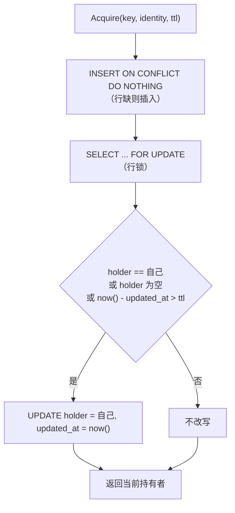
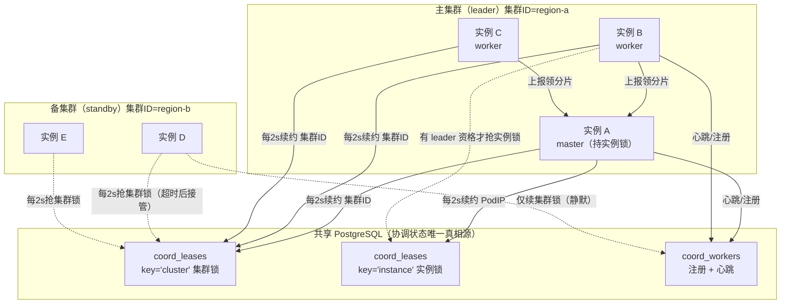
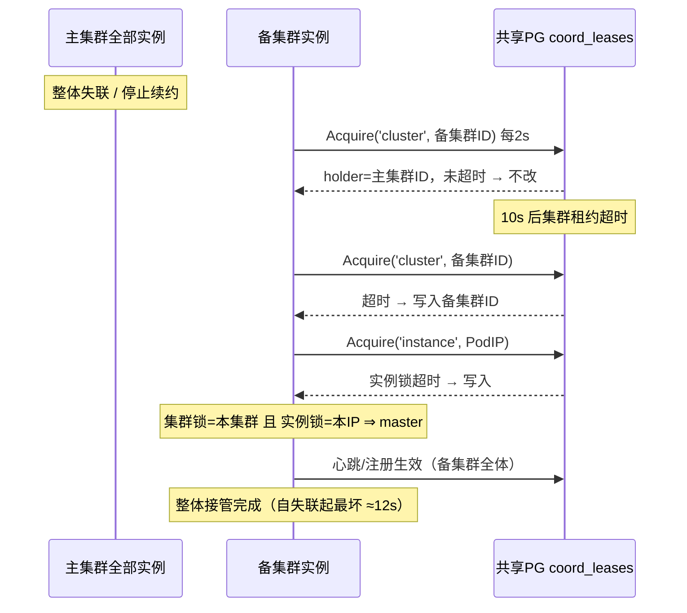
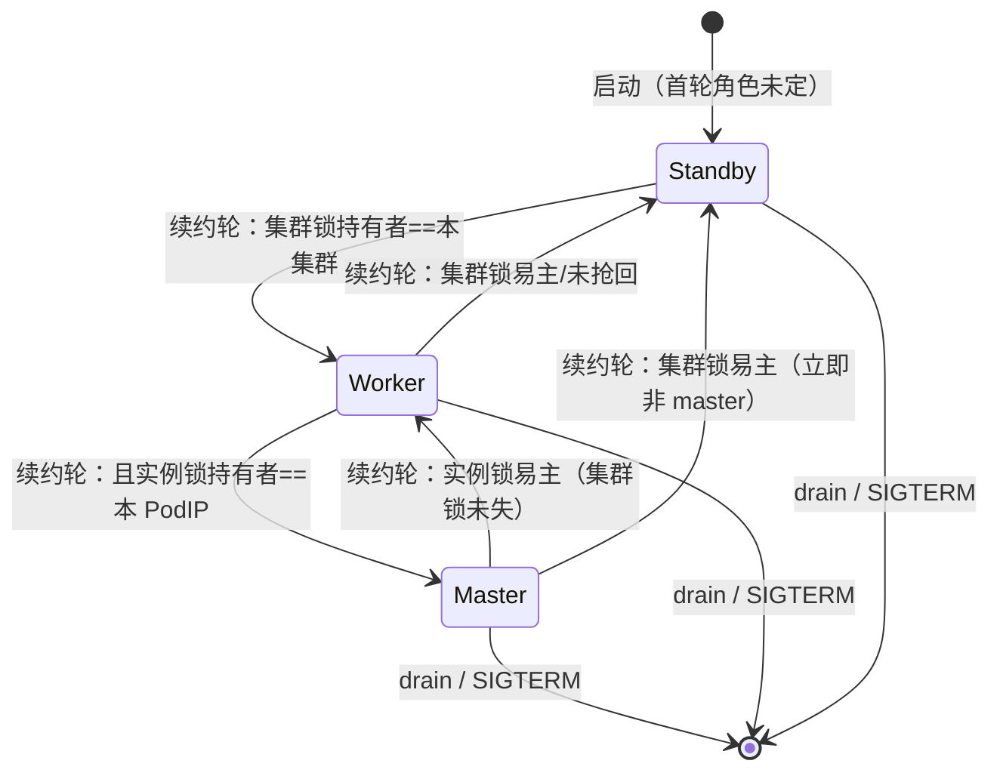
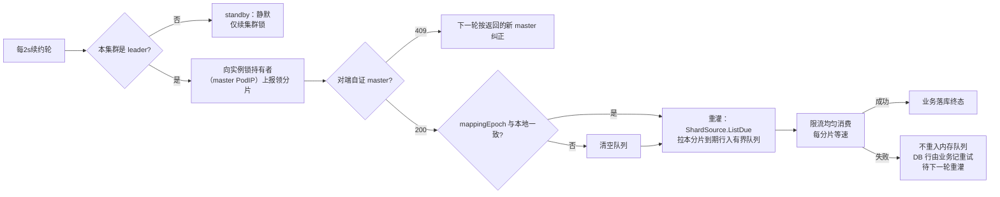
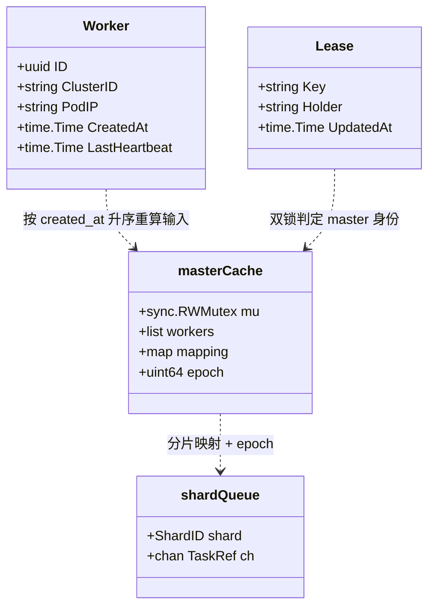

# hub 协调框架（coordination）设计文档

> 模块：hub `internal/coordination`（单组件，不涉 console/runner）；代码基线：hub `main` @ `bf0dfb9`
> 相关文档：[ADR-dispatch-durable-queue.md](https://github.com/rouroumaibing/software-distribution-platform-docs/blob/main/shared/ADR-dispatch-durable-queue.md)（dispatch_jobs 耐久队列，业务挂接候选）、[STORY-BACKLOG.md](https://github.com/rouroumaibing/software-distribution-platform-docs/blob/main/hub/STORY-BACKLOG.md)

## 1. 设计目的

**现状**（hub `main` @ `bf0dfb9`）：

- hub 以单副本部署（`deploy/manifests/20-hub.yaml` `replicas: 1`），所有协调状态默认单实例独占；
- 进程内后台任务对多实例零防御：
  - dispatch 下发重投 sweep：15s ticker，有 `MarkDispatching` 占坑，但占坑后本实例若不持有该 target 的 WS 连接，投递失败白耗 `attempts` 并进 backoff；
  - agent_op 升级超时 / 审批超时扫描：1min ticker，**无任何占坑**，多实例即重复处理；
- gateway 连接表为进程内存状态（`map + sync.RWMutex`），与后台任务间存在连接亲和问题；
- 主备两套集群部署没有自动切换机制，切备依赖人工。

**问题**：`replicas > 1` 一放开，后台任务重复执行或跨实例占坑浪费；跨集群容灾无"谁是主、谁干活"的判定依据。

**目的**：为 hub 增加基于共享 PostgreSQL 的协调框架——租约、两级选主（集群锁 + 实例锁）、worker 注册与心跳、分片映射重算、限流队列消费、优雅停止——达成：

1. **水平扩容**：后台工作按分片归属到实例，不重复消费；
2. **主备自动 failover**：主集群整体失联后，备集群在租约超时后整体接管，不脑裂，failback 对称无需人工；
3. **实例无本地状态**：选主结果与全部协调状态只存共享数据库，任意实例可随时销毁重建（与 K8s 副本语义对齐）。

**范围与前提**：

- 本设计只覆盖协调框架本身；具体业务工作（agent_op 派发、升级/审批超时扫描等）经通用 `ShardSource` 接口挂接，首挂对象与分片维度另行裁定（§2.6，待定项）；dispatch_jobs 投递在目标态走「WS 通知 + HTTP 拉取」混合（§2.6），切换后由 runner claim 直取、不经 hub 侧分片消费；
- 主备两套集群的 hub 连接**同一个共享 PG**——租约跨集群可见是两级选主成立的前提（部署拓扑约定）。共享 PG 自身为主备复制形态：统一对外地址指向可写 primary，后端为主备副本（同一份数据的复制，非两套独立库）；hub 各实例只配统一地址，PG 切换对应用层无感知。**「两套独立库」形态不可用**：租约表不共享则两集群各自持锁脑裂，两级选主失效；
- 共享 PG failover 三个已知项：① 切换期间连接全断，续约 tick 因 DB 错误降级 standby——全员静默等待，无误动作（§4.2 tick 的错误路径）；② 异步复制 RPO 窗口内丢写的最坏后果是不足一个 TTL（10s）的双主窗口，由租约超时自动收敛；run/dispatch_job 的写入丢失由业务重试兜底；③ 备集群接管 RTO = max(PG failover 耗时, 集群锁 TTL 10s)——PG 切换速度主导整体 RTO，统一地址层的健康检测与切换机制须自身 HA，且切换耗时须经「整集群灭 + PG 切换」组合场景实测；
- API 请求服务面不在选主范围内：任何实例都可服务 API；gateway 连接表仍是进程本地传输状态（非协调状态），其与分片的亲和问题归业务挂接时裁定。

**定性**：新模块（新增 `internal/coordination` 包 + 2 张表）。

**容灾视图（hub 侧拼图）**：容灾能力由四个平面构成，hub 侧全部就位——**登记面**：API 请求天然双活，任意实例写共享 PG（真相源唯一，无状态原子写无需仲裁）；**推进面**：后台工作由两级选主唯一仲裁，主集群全灭后备集群在 TTL 内接管（接管路径已在单集群多副本形态实测）；**传输面**：runner WS 断线重连自愈，重连触发 `DrainTarget` 补投 pending job；**数据面**：共享 PG 主备复制 + 统一对外地址保障（前提见上文）。入口流量由既有 LB/DNS 双活覆盖，hub 不参与；PG 切换耗时与整集群灭场景的实测、发布结果可信度（runner→hub 回流）不属于本模块——分别归容灾演练 gate 与回流 story。

## 2. 设计逻辑

### 2.1 为什么是共享 PG 租约（而不是 K8s Lease / etcd）

| 方案 | 结论 | 理由 |
|---|---|---|
| K8s Lease（`coordination.k8s.io`） | 否决 | 租约只在本集群 API Server 内可见——备集群实例读不到主集群的 Lease，跨集群选主无从谈起 |
| etcd / 独立协调服务 | 否决 | 新增一套基础设施；且每集群一套 etcd 后仍要解决跨集群可见性，问题没变 |
| 共享 PG 租约表 | **采用** | hub 的真相源本来就是 PG；主备集群天然共见同一张表；行锁原子性现成；10s 级租约写负载可忽略 |

**性能视图**：每实例每 2s 一个续约轮 = 集群锁 Acquire + 实例锁 Acquire + 心跳 upsert ≈ 3 个小事务，单实例约 1.5 QPS 写；10 实例约 15 QPS，对 PG 可忽略。接管延迟 = TTL（10s）+ 一个续约轮（≤2s）≈ 最坏 12s——后台工作协调可接受，不在请求路径上。

### 2.2 租约与抢锁语义（功能视图）

租约表 `coord_leases` 一行 = `(key, holder, updated_at)`。**抢锁与续约是同一操作**（Acquire），单事务行锁内四步：



要点：

- 调用方以「返回值 == 自己的身份」判定持有；
- **超时判定一律用 DB 时钟**（SQL 内 `now()` 比较），实例与跨集群时钟偏差不参与判定；
- `holder 为空` 是显式让位的结果（优雅停止/降级时置空），后来者免等超时；
- **一次性任务锁**：同一 Acquire 语义，`ttl = 10min`，不配续约循环——把一次性/低频单例任务收敛到单执行者；「只执行一次」由业务状态行保证，锁只保证同一租约窗口内至多一个执行者。

### 2.3 两级选主（核心视图）



**规则**：

- **集群锁**（key=`cluster`，身份=集群 ID，来源部署配置 `SDP_CLUSTER_ID`）：**集体租约**——主集群内**任一**实例每 2s 以集群 ID 续约即视为集群持有；只有主集群**全部**实例停止续约，租约才会超时。备集群实例同样每 2s 尝试 Acquire；主集群租约超时后，备集群抢到者写入备集群 ID，此后备集群**全体**实例的续约都命中「持有者==自己（本集群）」⇒ **整体接管**。
- **实例锁**（key=`instance`，身份=Pod IP，来源 Downward API）：集群内唯一持有者即 master。**抢实例锁以集群锁资格为前提**：每轮先看集群锁返回的持有者是否本集群，不是则本轮跳过实例锁——standby 实例永远不可能持实例锁。
- **master 判定**（每 2s 重估，双条件同时成立）：集群锁持有者==本集群 **且** 实例锁持有者==本 Pod IP。

| 判定结果 | 角色 | 行为 |
|---|---|---|
| 双条件成立 | **master** | 接收上报、重算分片映射、自身也作为 worker 参与均分 |
| 仅集群条件成立 | **worker（producer）** | 向 master 上报领分片、限流消费 |
| 集群条件不成立 | **standby** | 静默：不领分片不消费，仅续集群锁参与未来接管 |

**接管时间线**（备集群视角）：



**不脑裂论证**（接管窗口分析）：

- 旧主活着且能到 PG ⇒ 它的续约一直生效，接管根本不会发生——接管必然意味着主集群全部实例 ≥10s 未能续约（真死或分区）；
- 接管后旧主恢复的第一轮：集群锁持有者=备集群且未超时 ⇒ **立即非 master**（集群条件是 master 判定的先决项，实例锁行即使仍写着旧主 IP 也无效）；若它发现自己仍持实例锁则显式置空，加速新主接管；
- 残余风险窗口：旧主恰在实例锁超时后、备集群尚未抢到实例锁前恢复 ⇒ 可能短暂重持实例锁，但同轮集群条件失败即自我降级——至多出现 ≤1 轮（2s）**无 master** 空窗，不出现双 master；
- 旧主降级后**恢复续约参与**：其集群持续尝试集群锁，若备集群此后整体失联，主集群以同样机制再接管——failback 与 failover 对称。

**角色状态机**：



### 2.4 心跳、注册与分片映射（master 视角）

- **注册**：实例启动即 upsert `coord_workers`（`cluster_id + pod_ip` 唯一）；`created_at` 首次插入时确定，心跳不更新——worker 表按 `created_at` 升序即得确定性序；
- **心跳**：续约轮内顺带更新 `last_heartbeat`（2s 一次，不另设心跳通道）；
- **重算**：master 每续约轮从共享表重算视图：active worker = leader 集群内 `last_heartbeat` 未过期（心跳窗，默认 10s）的行，按 `created_at` 升序；分片映射 = 均分：分片 i → `workers[i mod N]`。worker 集合变化（扩缩容/崩溃/停止）即全量重映射，`mappingEpoch` 自增；
- **master 缓存加锁**：重算结果写入进程内 `masterCache`，读写经 `sync.RWMutex`——重算（续约轮 goroutine）写、上报 handler 读，二者并发；
- **由共享表重算的意义**：master 自身也是可随时销毁的——新 master 上任后从共享表重建全部视图，无需交接协议；worker 崩溃由心跳过期自动收敛剔除；
- 全部 leader 集群实例（**含 master**）都注册为 worker 参与均分——单实例部署时它既是 master 也是唯一 worker，行为退化为现状。

### 2.5 producer 流水线（worker 视角）



1. **先判集群级 leader**：非 leader ⇒ standby 静默；
2. **向 master 上报领分片**：master Pod IP 即实例锁持有者（每轮 Acquire 的返回值顺带可得），pod 间直连内部上报接口。**仅 master 可收上报**：对端先自证（双条件），非 master 一律 409 并附当前实例锁持有者，producer 下一轮按新持有者纠正；
3. **领到的分片入限流队列**：每分片一条有界内存队列；**重灌** = 周期从共享库经 `ShardSource.ListDue` 拉取本分片到期行灌入（队满则少灌，下轮补）；消费端每分片等速（令牌桶/轮转）⇒ **均匀消费**，整体速率上限可配（保护下游 PG / gateway）；
4. **失败不重入**：消费失败项从内存队列丢弃，**绝不重新入队**（防毒丸热循环）；DB 行留在原状态、由业务语义决定重试（`attempts++` / `next_retry_at` 推后），等下一轮重灌自然再拉；
5. **映射变更**：上报响应携带 `mappingEpoch`，与本地不符 ⇒ 清空全部队列、按新分片集合重灌——内存队列只是共享库的瞬态投影，清队列不丢工作。

### 2.6 业务挂接（ShardSource，本设计留白）

协调框架对业务暴露两个挂接点：`ShardSource`（分片键空间 → 到期行清单，重灌的数据来源）与 `TaskConsumer`（消费一项；失败落重试语义归业务）。分片维度、键空间划分、ListDue 语义由挂接方定义。

**端到端消费链路（页面触发一次 run）**：① console 保存流水线定义 = 纯数据落库，无执行语义；② console 点击运行 = run 创建请求（POST /runs）经网关落在**任意** hub 实例——API 服务面不在选主范围内，运行任务落库与两级选主解耦——该实例创建 run，并按 1 run × N target 扇出 N 条 `dispatch_job`（各自携带完整 spec payload）落库；③ 交付为**双轨**（已落地）：推送轨沿用现状（hub 对连接中的 target 直接 WS 推完整 payload，失败进退避重投）；拉取轨为 runner 对任意实例 `POST {gateway path}/claims` 原子领取到期行（占坑与推送轨共用 `MarkDispatching`，一个 job 只被一轨交付），runner 以低频轮询兜底（`SDP_CLAIM_INTERVAL`，默认 30s，0 关闭）；④ 领取到的 payload 经 runner 既有 apply 通道物化执行；⑤ 执行结果经既有 runner→hub 通道回写。选主/分片框架不参与步骤 ②④——它只约束 hub 侧后台工作（sweep、重投等）的门控与归属，不约束 API 接收与 runner 拉取。A 类扫描门控已接线：dispatch 重投（`SweepPending`）、run 超时与 queued promotion（`RunBackground`）、审批超时（`RunApprovalTimeouts`）、agent_op 升级/审批超时五处 sweep 前置 `Role() == master` 判断，standby 静默跳过、接管后自动恢复；report-only 对账与幂等 GC 不门控（重复执行无害）；cron 触发器已在行级用 `FOR UPDATE SKIP LOCKED` 原子领取，天然多实例安全。

候选首挂对象是 dispatch_jobs 下发重投 sweep（现 15s 全表 `ListDueRetry`）。其每条记录是一个**独立投递工作单元**（把一个 run 的 spec 交付给一个 target 的 runner；1 run 扇出 N target = N 条独立行，redispatch 生成新行，`MarkDispatching` 占坑把并发收敛到单投递），行间无共享资源互斥，语义上适配分片消费。

**投递传输方向裁定（目标态 = 多实例 / 主备集群；双轨过渡态已落地——WS 推送轨保留，runner claim 拉取轨上线，两轨经 `MarkDispatching` 占坑互斥并存；轻量通知 + 推送退出为后续切换 story）**：投递采用「WS 通知 + HTTP 拉取」混合——runner 经网关向**任意** hub 实例 POST claim 领取 dispatch_jobs 到期行（PG 单源 + `MarkDispatching` 占坑幂等，批量领取按 runner 容量背压）；WS 下行只发轻量「有活」通知，**丢失无害**（低频轮询兜底，只影响延迟不影响正确性）。据此：WS 连接亲和不再是投递正确性依赖（连接表不参与 claim 路径），分片映射只承担负载分布、不绑定连接归属；切换完成后 dispatch_jobs 由 runner claim 直取，**退出 hub 侧 ShardSource 消费候选**。hub 侧 `ShardSource` 首挂候选为 agent_op 派发、升级/审批超时扫描，首挂对象与分片维度**待后续 story 裁定**，本设计不预设。

### 2.7 优雅停止（drain）

- **须鉴权**：运维主动 drain 走内部 admin 端点（platform-admin 角色）；SIGTERM（K8s 滚动更新）复用同一 drain 例程，属进程自身生命周期，不经 HTTP；
- **固定层级序：先集群锁，后实例锁，最后删 worker 注册**——所有路径以同一顺序操作，避免乱序竞态：
  1. **集群锁**：退出续约集合（停止以集群 ID 续约）。集体租约**不允许单成员置空**——锁行留给同集群其余实例；若这是最后一个实例，集群租约自然开始 10s 倒计时 ⇒ 备集群自动接管（即计划性整体切换的路径）；
  2. **实例锁**：若自己持有则**显式置空**（免得新主等 10s 超时）；
  3. **worker 注册**：删除自己的 `coord_workers` 行 ⇒ master 下一轮重算即把该实例的分片均分给剩余 worker（无需等心跳过期）；
- drain 后实例不再领新分片；在飞消费按业务幂等性兜底（占坑/attempts 语义由业务挂接方提供）。

### 2.8 配置与退化

| 配置 | 默认 | 说明 |
|---|---|---|
| `ENABLE_DUALCLUSTER` | `false` | 未启用时实例自视为独占 master，行为与现状等价（单实例开发模式） |
| `SDP_CLUSTER_ID` | 启用时必填 | 集群身份，主备两套部署取不同值 |
| 续约间隔 / 租约 TTL / 心跳窗 | 2s / 10s / 10s | TTL = 5 个续约周期容忍；接管最坏 ≈12s |
| 一次性任务租约 | 10min | 不续约 |
| 队列每分片容量 / 整体消费速率上限 | 可配 | 超出队满少灌，速率保护下游 |

## 3. 核心数据结构

### 3.1 持久层（真相源；AutoMigrate 只加不删）

```go
// coord_leases —— 租约表：集群锁 / 实例锁 / 一次性任务锁共用
type Lease struct {
    Key       string    // 租约键：'cluster' | 'instance' | 'task:<name>'，PK
    Holder    string    // 持有者：集群ID / PodIP / 实例标识；空串=已显式让位
    UpdatedAt time.Time // 最近续约时间（DB 时钟写入）
}

// coord_workers —— worker 注册表：注册与心跳一体
type Worker struct {
    ID            uuid.UUID // PK
    ClusterID     string    // 与 PodIP 联合唯一
    PodIP         string    // 与 ClusterID 联合唯一
    CreatedAt     time.Time // 注册时间（排序键，心跳不更新）
    LastHeartbeat time.Time // 最近心跳（续约轮更新）
}
```



说明：

- 两表与协调以外的业务表**零外键关联**（协调层不掺业务语义）；
- 一次性任务锁不建独立表，复用租约行（key 前缀 `task:`）；
- 僵尸 worker 行（实例崩溃无 drain）：心跳过期即被 master 重算剔除；行超阈值（如 1h 无心跳）由 master 顺手删除——删除是清理不是正确性依赖（过期判定已足够）；
- Pod IP 复用（新实例拿到崩溃旧实例的 IP）：upsert 命中旧行继续心跳，`created_at` 沿用旧值——排序只要求确定性不要求公平，可接受。

### 3.2 进程内结构（投影，非真相源）

```go
// master 缓存（RWMutex 保护；master 角色专属）
type masterCache struct {
    mu      sync.RWMutex
    workers []WorkerView       // 按 CreatedAt 升序的活跃 worker
    mapping map[ShardID]string // 分片号 → PodIP
    epoch   uint64             // 映射版本，重算自增
}

// worker 侧分片队列（有界；瞬态投影，清空不丢工作）
type shardQueue struct {
    shard ShardID
    ch    chan TaskRef
}
```

## 4. 接口定义

### 4.1 租约接口

```go
/// 抢锁/续约同一路径：事务行锁内"插入缺失行→判定→写入"，返回执行后的持有者。
/// 调用方以 返回值==identity 判定持有；ttl 用 DB 时钟比较。
func (s *LeaseStore) Acquire(ctx context.Context, key, identity string, ttl time.Duration) (holder string, err error)

/// 显式置空（仅当当前持有者是 identity）：优雅让位，后来者免等超时。
func (s *LeaseStore) Release(ctx context.Context, key, identity string) error
```

内部 SQL 语义（Acquire 的报文形状）：

```sql
BEGIN;
INSERT INTO coord_leases (key, holder, updated_at)
  VALUES ($1, $2, now()) ON CONFLICT (key) DO NOTHING;
SELECT holder, updated_at FROM coord_leases WHERE key = $1 FOR UPDATE;
-- 仅当 holder = $2 OR holder = '' OR now() - updated_at > $3 时执行：
UPDATE coord_leases SET holder = $2, updated_at = now() WHERE key = $1;
COMMIT;  -- 返回执行后的 holder
```

### 4.2 选主循环

```go
/// 每实例一个：2s ticker。每轮 = Acquire 集群锁 → 判 leader 资格 →
/// 有资格才 Acquire 实例锁 → 更新心跳 → 重估角色（master/worker/standby）。
func (c *Coordinator) Run(ctx context.Context) error

/// 原子读当前角色；业务侧以此判定"是否 master 收上报 / 是否消费本分片"。
func (c *Coordinator) Role() Role // RoleMaster | RoleWorker | RoleStandby

/// 一次性任务锁：同 Acquire 语义，ttl=10min，无续约循环。
func (c *Coordinator) OneShotLock(ctx context.Context, name string) (acquired bool, err error)
```

**协作总结**：实例启动即 `Run` 进入 2s 续约循环，角色由每轮双锁判定驱动；业务在任意时点读 `Role()` 获得一致性角色视图。

### 4.3 worker 注册 / 心跳

```go
/// 启动注册（upsert；首次插入固定 created_at）
func (r *WorkerRegistry) Register(ctx context.Context, w Worker) error

/// 心跳（续约轮内调用）
func (r *WorkerRegistry) Heartbeat(ctx context.Context, clusterID, podIP string) error

/// 主动注销（drain 第 3 步）
func (r *WorkerRegistry) Deregister(ctx context.Context, clusterID, podIP string) error

/// master 重算输入：leader 集群内心跳未过期的 worker，按 created_at 升序
func (r *WorkerRegistry) ListActive(ctx context.Context, clusterID string, heartbeatWindow time.Duration) ([]Worker, error)
```

### 4.4 上报（内部 HTTP，pod 间直连；仅 master 可收）

```
POST /internal/coordination/report
{ "podIP": "10.1.2.3", "clusterID": "region-a" }

→ 200 { "shards": [3, 7, 11], "mappingEpoch": 42 }
→ 409 { "master": "10.1.2.9" }        // 对端非 master：拒绝并指路
```

- master handler 先自证（`Role() == RoleMaster` 双条件），失败一律 409——**仅 master 可收上报**；
- 该端点只暴露于 pod 网络：外部网关只路由 `/api`，`/internal` 不经网关（安全边界 = 网络边界，见 §5）。

### 4.5 分片消费挂接（业务接口）

```go
/// 业务提供：把分片号集合翻译为键空间，并列出其中到期可消费的行（重灌数据来源）。
type ShardSource interface {
    Keyspace(ctx context.Context, shards []ShardID) (any, error)
    ListDue(ctx context.Context, ks any, limit int) ([]TaskRef, error)
}

/// 业务提供：消费一项。返回 error = 失败 = 不重入内存队列；
/// 重试语义由业务落库（attempts / next_retry_at 等）承担。
type TaskConsumer interface {
    Consume(ctx context.Context, ref TaskRef) error
}
```

### 4.6 停止

```
POST /api/v1/admin/coordination/drain      # platform-admin 角色鉴权
```

drain 例程（HTTP 与 SIGTERM 共用，固定层级序）：

1. 置 stopping（停领新分片、停消费）；
2. 集群锁：退出续约集合（**不置空锁行**——集体租约语义）；
3. 实例锁：若持有则 `Release` 置空；
4. `Deregister` 删 worker 注册行。

## 5. 一致性校验

**概念一致性**：集群锁（集体租约，身份=集群 ID）、实例锁（个体租约，身份=Pod IP）、master（双条件）、worker=producer（leader 集群内非 master 实例）、standby（非 leader 集群实例）、上报、分片、重灌、心跳——全文同术语。已知易混点：集群锁的「停止」= 退出续约（锁行留同集群其余实例），实例锁的「停止」= 显式置空——因集体/个体语义不同，§2.7 与 §4.6 两处已显式区分。

**状态完备性**：角色状态机对每个输入事件的处理（含降级路径）：

| 当前角色 | 事件 | 结果 |
|---|---|---|
| master | 续约轮：集群锁 OK + 实例锁 OK | 保持 master |
| master | 续约轮：集群锁失（易主/未抢回） | **立即非 master**；若仍持实例锁 → 置空；→ standby |
| master | 续约轮：集群锁 OK + 实例锁易主 | → worker |
| worker | 续约轮：抢到实例锁 | → master |
| worker | 续约轮：集群锁失 | → standby |
| standby | 续约轮：抢到集群锁（本集群） | → worker（同轮可竞实例锁） |
| 任意 | 收到上报且非 master | 409 拒收 |
| 任意 | drain / SIGTERM | 停止续约 → 释放 → 注销 → 退出 |

**接口完备性**：§2 提及操作均有接口——抢锁/续约（`Acquire`）、置空（`Release`）、注册/心跳/注销、重算（`ListActive` 输入 + `masterCache`）、上报（HTTP）、重灌/消费（`ShardSource`/`TaskConsumer`）、drain（HTTP + SIGTERM）、一次性锁（`OneShotLock`）、角色查询（`Role`）。

**层次一致性**：协调层只管"谁干哪些分片、什么节奏干"——不掺业务重试语义（失败落库归业务），不吞 gateway 连接表（连接亲和由投递传输方向裁定消解，§2.6）。

**非功能四维**：

| 维度 | 检查结论 |
|---|---|
| 安全性 | `/internal` 仅 pod 网络可达（网关只路由 `/api`）；drain 端点 platform-admin 鉴权；SQL 全参数化；集群 ID/Pod IP 来自受控注入（env / Downward API）。**待定**：上报端点无应用层鉴权，依赖 pod 网络边界——若该假设不成立需补 token/mTLS |
| 可靠性 | 实例无本地持久状态可随时重建；队列=投影清空不丢工作（DB 真相源）；毒丸防护（失败不重入）；显式置空免等超时；心跳过期剔除幽灵 worker；`ON CONFLICT` 幂等支持续约轮乱序重放 |
| 可测试性 | `Acquire` 四分支（行缺/自持/空持/超时）+ 并发行锁串行化可 PG 单测；角色循环可用 fake LeaseStore 单测；双集群接管可两实例 + 断网模拟 e2e |
| 可调试性 | 角色跃迁（升/降 master、进/出 leader）打 INFO 带原因；续约轮 debug 日志；`coord_leases`/`coord_workers` 可直接 SQL 巡检——可观测入口天然存在 |

**软门禁结论**：设计闭环，可进入实现排期。显式待定项两项：① hub 侧 `ShardSource` 首挂业务与分片维度（§2.6；dispatch_jobs 经传输方向裁定改由 runner claim 直取，首挂候选为 agent_op 派发 / 超时扫描，后续 story 裁定）；② 上报端点 pod 网络边界假设不成立时的鉴权补强。

## 6. 变更历史

| 日期 | 变更内容 | 原因 |
|---|---|---|
| 2026-11-17 | 初版：租约表与抢锁语义、一次性任务锁、两级选主（集群锁/实例锁）与不脑裂论证、心跳注册与分片映射重算、producer 限流队列消费（失败不重入待重灌）、优雅停止（先集群锁后实例锁、删 worker 注册）、ShardSource 业务挂接留白 | hub 由单副本走向多实例水平扩容 + 主备集群容灾，需要"协调状态只存共享库、实例可随时重建"的选主与分片消费框架 |
| 2026-11-17 | 投递传输方向裁定：目标态（多实例/主备集群）采用「WS 通知 + HTTP 拉取」混合——runner 经网关向任意实例 claim 领取（PG 单源 + `MarkDispatching` 幂等、按容量背压），WS 下行降为可丢通知、低频轮询兜底；WS 连接亲和从投递正确性依赖降级为通知延迟优化（原三套绕行方案作废），分片映射只承担负载分布；dispatch_jobs 切换后由 runner claim 直取、退出 hub 侧 ShardSource 候选（首挂候选改为 agent_op 派发 / 超时扫描）；现状 WS 推送保留至切换 story 完成（§2.6 同步） | 多实例下"target 连接在哪个实例"是推送模式的根本代价；双向钢人论证（评估对象裁定为目标态）：混合拉取在状态单源、故障恢复、背压正确性上占优，通知保住零延迟，批量领取保住吞吐 |
| 2026-11-25 | §2.6 补端到端消费链路：页面保存流水线 = 纯落库；页面点击运行 = POST /runs 由任意 hub 实例接收并落库 run + 按 target 扇出 dispatch_job（API 服务面不在选主范围）；交付通知与 runner claim 沿用本节传输裁定（现状 WS 推完整 payload，目标态轻量通知 + runner 向任意实例 claim）；明确选主/分片只约束 hub 侧后台工作门控，不约束 API 接收与 runner 拉取 | 用户对消费逻辑的理解确认（期望形态与已裁定目标态一致）；澄清「接收运行请求的实例 = 选主 master」的偏差——API 面强制走 master 会使其成为请求瓶颈且选主抖动放大为 API 不可用，维持任意实例接收 |
| 2026-11-25 | §1 部署前提补共享 PG 容灾形态：主备复制（统一对外地址指向可写 primary，后端主备副本，数据单份复制），hub 各实例仅配统一地址、PG 切换无感知；明确「两套独立库」形态不可用（租约表不共享 → 两集群各自持锁脑裂，两级选主失效）；补 failover 已知项三条：连接全断 → 续约 tick 降级 standby（§4.2 错误路径）、RPO 丢写 → 不足 TTL 的双主窗口由租约超时收敛、接管 RTO = max(PG failover, TTL 10s) 且统一地址层须自身 HA | 用户确认 PG 形态为主备复制（统一对外地址 + 后端两套副本）；RTO 由 PG 切换速度主导，切换耗时须纳入「整集群灭 + PG 切换」组合场景的容灾演练实测 |
| 2026-11-25 | §1 补容灾视图：hub 侧四平面（登记面 API 天然双活 / 推进面两级选主仲裁 / 传输面 WS 重连自愈 + DrainTarget 补投 / 数据面 PG 主备复制）全部就位，入口流量由既有 LB/DNS 双活覆盖；§2.8 开关更名 `SDP_COORDINATION_ENABLED` → `ENABLE_DUALCLUSTER`（Go 字段同步 `DualClusterEnabled`，hub 仓 config/启动校验/chart env 同步改名，历史实跑记录中的旧名不回改） | 用户拍板：开关名语义化表达双集群容灾意图；容灾四平面结论经跨领域分析（登记写无需仲裁、唯一性只属后台推进）与用户逐面确认后落档 |
| 2026-11-25 | §2.6 双轨过渡态落地：① runner claim 拉取轨上线——hub 新增 `POST {gateway path}/claims`（身份沿用 WS 三态鉴权、enroll token 不在 HTTP 上消费，未知 target 404 不自动注册），claim 与推送轨共用 `MarkDispatching` 占坑（领取即标 dispatched，与推送轨「写成功后标记」语义对齐），runner 新增 claim 轮询（`SDP_CLAIM_INTERVAL` 默认 30s、0 关闭；apply handler 未就绪不触 hub，避免领取后无人消费）；② A 类扫描门控接线——五处 sweep 前置 `Role() == master`（report-only 对账与幂等 GC 不门控；cron 触发器经 SKIP LOCKED 行级领取确认天然多实例安全，无需门控）；hub/runner 双仓 build/vet/test/gofmt 全绿，claim 占坑互斥与门控语义有单测 | 实现「WS 通知 + HTTP 拉取」裁定的过渡形态：推送轨保住零延迟，拉取轨兜底推送失败与通知丢失；跨域调研结论（正确性=原子占坑、效率=选主门控）在本轮兑现为代码 |
