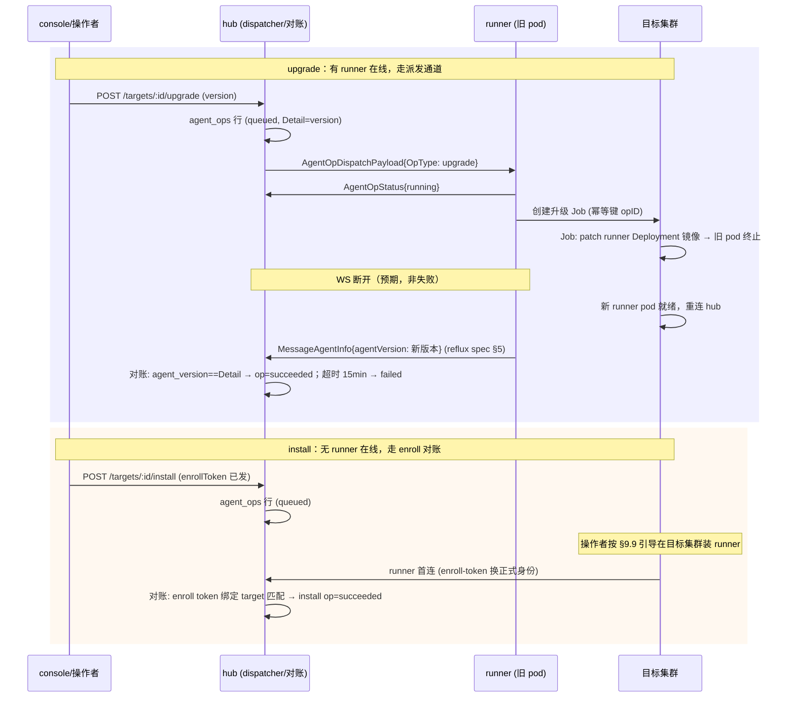
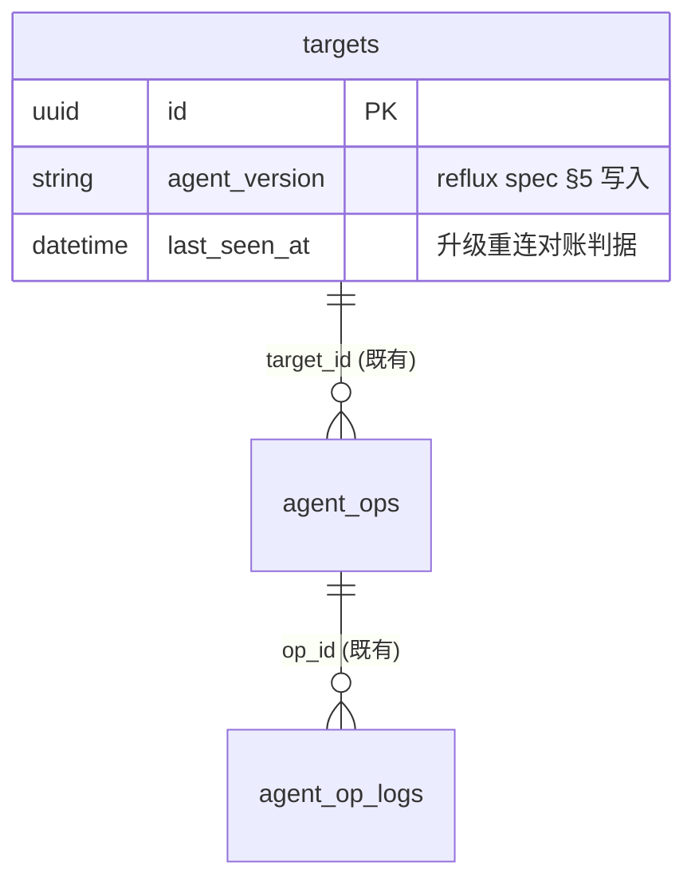

# INSTALL-UPGRADE-EXECUTOR-DESIGN：agent_ops install/upgrade 执行器设计（2026-10-08）

- **状态**：Design（设计定稿，本轮落实）
- **住户依据**：横跨 runner（upgrade 执行体）+ hub（派发/对账）+ console（台账展示）三端，按「范围优先」判据入住 `shared/`
- **覆盖缺口**：STATUS §2 **#1**（install/upgrade 执行器，§9.9 接入引导）、**#3 的执行体半边**（平台自升级审批流的「审批通过后无执行体」阻塞）
- **关联**：runner-reflux-spec.md §5（升级完成后新 runner 经身份帧上报 agent_version，本设计的验收数据源）

## 1. 设计目的

当前系统（三仓 main，2026-10-08）的 agent_ops 台账已受理三种 op（`AgentOpExec/Install/Upgrade`，hub `internal/target/models/agent_op.go:12-15`），但派发器对 install/upgrade **明确跳过**（`cmd/hub/agentop_dispatcher.go:45-48`，等 §9.9 bootstrap），runner 侧 handler 拒绝非 exec 类型（`internal/agentops/handler.go:154-155`）。后果：install/upgrade 台账行**永远 queued**，console「已受理待执行」语义成为死态；平台自升级审批流（#3）即使审批通过也无执行体。本设计目的是**为 install/upgrade 补上执行半程**，使台账从「受理」走到「终态」。

## 2. 设计逻辑

### 2.1 核心挑战与取舍

**挑战一：install 的鸡生蛋问题**——install 的目标是没有 runner 的目标集群，而派发通道（gateway WS）要求 runner 已在线。hub 无 client-go（三层边界①②），不能自己下集群装。

**取舍（裁定）**：install 不做「runner 执行安装」，改为 **enroll 对账收口**——install op 保持 queued，当目标集群的 runner 首次凭 enroll-token 完成接入（ADR-0001 一次性 bootstrap），hub 在握手对账时把匹配的 install op 推进到 succeeded。这复用了既有接入流，不引入「hub 遥装」这条被三层边界禁止的路径。

**挑战二：upgrade 的自毁式升级**——runner 升级要替换 runner 自己的 pod，Job 执行中上报通道随 pod 一起消失。

**取舍（裁定）**：升级 Job 分两步走——旧 runner 收到 upgrade op 先报 running，再创建升级 Job（拉新镜像 → 替换自身 Deployment 的镜像 tag → 等待 rollout 完成），上报通道中断是**预期行为**；hub 侧以「新 runner 重连 + 身份帧 agent_version 变化」作为 upgrade 成功的对账信号，超时（默认 15min）未重连则 op 判 failed（台账可观测，不静默悬挂）。

### 2.2 流程视图



## 3. 核心数据结构

复用既有 `AgentOp`/`AgentOpLog` 表（**零新表**）；仅两处扩展：

| 扩展 | 内容 | 迁移方式 |
|---|---|---|
| `AgentOp.Detail` 语义 | upgrade=目标版本（既有）；install=enrollToken ID（新增约定） | 无 schema 变更 |
| `targets` 表对账字段 | `last_seen_at`（升级重连对账的时效判据）随 reflux spec §5 一并落 | AutoMigrate 只加 |



## 4. 接口定义

### 4.1 runner 侧（upgrade 执行体）

```go
// internal/agentops/handler.go —— 扩展 execute() 的 op-type 分支
// case runnerapi.AgentOpTypeUpgrade → 执行体:
//   1. 幂等检查: 按 label sdp.io/upgrade-op=<opID> 查 Job，已存在则只报 running
//   2. BuildUpgradeJobSpec(opID, targetVersion): Job 跑在 runner 自身 ns，
//      SA=runner 自身 SA（部署前提：SA 有 patch deployments 权限，见 §6）
//      镜像=harbor.sdpworkflow.com/sdp/runner:<version>（harbor 全切命名）
//      Job 容器逻辑: kubectl set image + kubectl rollout status --timeout
//   3. 创建后即返回——后续对账靠 hub（2.2 图），runner 不等 Job 完成
//   （runner pod 可能先于 Job 结束被替换，等待逻辑放在 hub 对账侧）

// BuildUpgradeJobSpec 是纯函数（同 BuildJobSpec 先例），可单测
func BuildUpgradeJobSpec(opID, ns, image string) (*batchv1.Job, error)
```

### 4.2 hub 侧（派发放行 + 双对账）

```go
// cmd/hub/agentop_dispatcher.go —— Dispatch() 放行 upgrade
//   op.OpType == AgentOpUpgrade → buildPayload（Detail=version 原样透传）→ gw.DispatchAgentOp
//   op.OpType == AgentOpInstall → 仍 return nil（不派发，等 enroll 对账）

// internal/gateway/agentinfo.go（reflux spec §5 落点）—— 两个对账钩子:
//   onAgentInfo(payload): 若 pending upgrade op 存在且 payload.AgentVersion==op.Detail
//     → op=succeeded("upgraded to "+version)
//   onHandshake(target, enrollTokenID): 若 pending install op 存在且 Detail==enrollTokenID
//     → op=succeeded("installed via enrollment")

// internal/target/service —— 超时对账器（复用 ticker 模式）
//   upgrade op running 超 15min 且 targets.last_seen_at 未前进 → op=failed("upgrade timeout")
//   （幂等：仅对 running 态操作，终态不可变——IsValidAgentOpTransition 已守卫）
```

### 4.3 console 消费

```ts
// AgentOpsView 既有台账 + SSE 通道直接展示 upgrade/install 进度，无新 API；
// 升级完成后 targets.agent_version 变化由版本矩阵（reflux spec §5）自然反映
```

## 5. 一致性校验

| 维度 | 结论 |
|---|---|
| 概念一致性 | 「派发通道 upgrade / enroll 对账 install / hub 对账终态」三个机制全文同名；不与 exec 的「直连执行」概念混用 |
| 状态完备性 | queued（未连接/未派发）→ running（已派发/Job 已建）→ succeeded（重连对账命中）/ failed（超时/Job 失败可见日志）；终态不可变由既有 `IsValidAgentOpTransition` 守卫；WS 断开不算 failed（对账窗口内重连即成功） |
| 接口完备性 | §2 流程图每个箭头（派发/建 Job/状态上报/身份帧对账/enroll 对账/超时判定）在 §4 均有落点 |
| 层次一致性 | hub 仍无 client-go（Job 在 runner 集群由 runner 创建）；runner 不写 hub 台账（只报状态，终态判定在 hub）；console 只读 |
| 安全性 | upgrade 派发走既有 gateway 认证 WS；升级镜像固定 harbor 命名空间（不可注入任意 registry）；SA 权限收窄为 patch 本 ns deployment |
| 可靠性 | 幂等：Job 按 opID 幂等、对账按终态守卫；悬挂恢复：15min 超时对账器兜底 |
| 可测试性 | BuildUpgradeJobSpec 纯函数单测；hub 对账钩子可注入假 agent_version 序列单测；E2E 走 kind 集群真实升级一轮 |
| 可调试性 | upgrade Job 日志经 AgentOpLog 通道回流（复用 exec 日志差量机制）；对账命中/超时均写 op.Message |

## 6. 部署前提（非代码缺口，登记）

1. runner SA 需增加 `apps/deployments: patch, get`（自身 ns）——chart values 开关 `runner.selfUpgrade.enabled`，默认 **off**，开启时 chart 自动补 RBAC；
2. 升级镜像必须预先存在于 harbor（`harbor.sdpworkflow.com/sdp/runner:<version>`），与 #22 镜像入库流程共用；
3. #3 的「平台自升级审批流」完整版（审批角色矩阵、到期回收）仍留守——本设计只解除「审批通过后无执行体」的阻塞，审批 UI/角色矩阵等产品语义另行立项。

## 7. 变更历史

| 日期 | 变更内容 | 原因 |
|---|---|---|
| 2026-10-08 | v1 初稿 | STATUS #1 由「留守」转「落实」：用户确认 kind 环境可验证；install 采用 enroll 对账方案绕开鸡生蛋，upgrade 复用 exec Job 模式 |
