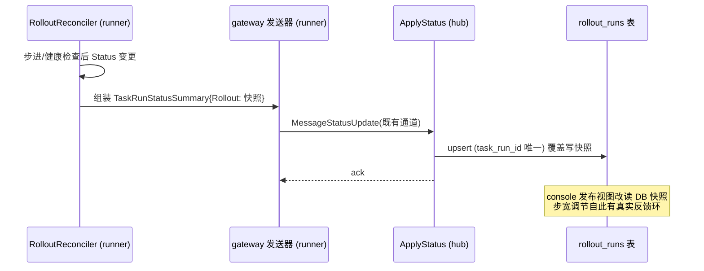
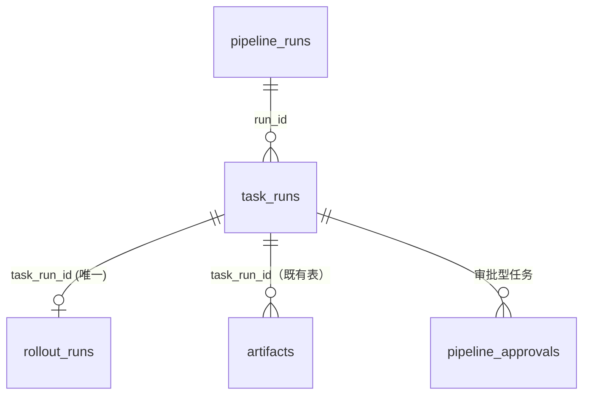

# RUNNER-REFLUX-SPEC：runner → hub 状态回流协议设计

- **状态**：Design（设计定稿，本轮落实；实现 gate = kind 流量测试床，见 §8）
- **住户依据**：横跨 runner（发送）+ hub（落库）+ console（消费）三端，按「范围优先」判据入住 `shared/`（原 plans/ 位置废止）
- **覆盖缺口**：STATUS §2 **#8**（canary `CurrentWeight` 回传）、**#16**（TaskRun 产物/结果落库）、**#2**（agent_version / per-target 身份上报）、**#20 的 hub 侧半边**（通知已读 + 审批 assignee）
- **性质**：这是 STATUS 盘点结论中**唯一协议级真缺口**。四件事共享同一条 runner→hub 回流通道，一次立项全部解决。

---

## 1. 现状（按实际代码，不臆想）

| 事实 | 证据 |
|---|---|
| runner→hub 已有两条上行消息：`MessageStatusUpdate`（run phase + TaskRunStatusSummary 列表）、`MessageLogChunk` | runner `api/v1alpha1/gateway_payloads.go:9-28` |
| hub 侧 `ApplyStatus` 持久化 run/task 相位 | hub `internal/run/service/pipeline_run.go:378` |
| `RolloutRun` 模型**已建**（phase / currentStepIndex / currentWeight / start/completion），AutoMigrate 已含 | hub `internal/run/models/rollout_run.go:13-26`、`internal/db/db.go:96` |
| 但 `TaskRunStatusSummary` **没有** rollout/权重/产物字段，runner 也**不上报** agent_version → `RolloutRun` 行始终没有数据来源，`targets.agent_version` 永远为空 | runner `api/v1alpha1/pipelinerun_types.go:270-278` |
| Rollout 写路径全部收口在 runner 侧 reconciler（注解驱动），runner 产出 `CurrentWeight` 后无处可送 | runner `RolloutControlPayload` 注释、`gateway.go` 下行分发 |

## 2. 设计目的与总原则

### 2.1 设计目的（为什么要做）

当前系统（三仓 main 分支）的执行态回流是**半程**的：runner 在目标集群内完成了灰度步进、产物产出、版本自证三件事，但 hub 侧的 `rollout_runs` 行恒空、`task_run_artifacts` 无从谈起、`targets.agent_version` 恒为空串。后果：① console 灰度控制台用任务完成数**猜测**权重（`ReleaseDetailView.vue` 注释自述），步宽调节没有真实反馈环；② 构建产物只能靠人工从目标集群捞取，签名下载通道（B-16）形同虚设；③ 版本兼容性检查（#2 下半）因无版本数据无法实现。本设计目的是**打通 runner→hub 的执行态回流后半程**，使 hub 成为执行态的完整权威镜像。

### 2.2 概念空间

| 概念 | 定义 | 由哪些已有概念组成 |
|---|---|---|
| **回流快照**（StatusSnapshot） | runner 每次 Status 变更时沿既有 StatusUpdate 通道上行的一次性全量摘要；按「最后一次快照」语义覆盖写，无增量协议 | `MessageStatusUpdate` + `StatusUpdatePayload`（既有）+ 新增可选扩展字段 |
| **灰度快照**（RolloutStatusSummary） | 回流快照中单个 Rollout 型任务在上报时刻的 phase/step/weight 三元组 | `Rollout.Status`（runner CRD）投影 |
| **产物上报**（ArtifactReport） | 任务产出的一个制品的元数据 + location；内容本身不走本协议（仍走对象存储通道），本协议只落**元数据** | `Produces` 声明 + 运行时产物清单 |
| **身份帧**（AgentInfoFrame） | runner WS 握手/重连时发送的一次性自证帧，携带版本与能力声明 | runner 二进制 build info + target 身份 |
| **服务端已读游标**（ServerReadCursor） | hub 按 subject 维护的通知已读时间戳，取代 console 本地游标成为权威 | `notification_reads` 表 + 既有通知流 |

### 2.3 设计总原则

1. **单通道复用**：不新增 run 状态相关 WS 消息类型，全部挂到既有 `MessageStatusUpdate` 的 payload 扩展上（可选字段，旧 runner 不发 = 旧行为，**向后兼容**）。唯一新增消息是身份帧 `MessageAgentInfo`（§5）——它是握手期一次性帧，与 run 通道生命周期不同，复用反而要在每次 StatusUpdate 里捎带冗余版本数据。
2. **相位权威不变**：`pipeline_runs.phase` 仍由 StatusUpdate 驱动；本协议只增数据，不改既有相位语义（`approval_timeout.go:112` 的约束原样保留）。
3. **幂等**：快照类字段按「最后一次快照」覆盖写；产物上报带 `(taskRunRef, seq)` 唯一键，hub 侧 upsert。
4. **瘦身边界**：产物**内容**仍走对象存储（已有 `POST /artifacts/storage-url` 通道），回流 payload 只带**元数据 + location**。

**取舍记录**：曾考虑为灰度快照单开 `MessageRolloutStatus` 新消息类型——放弃：权重是低频量，单通道可选字段即可承载，且新类型要求 hub 端分发器、runner 端发送器各多一条注册路径，两端同步发布才能生效；扩展字段允许新旧版本任意组合上线（§7）。

## 3. #8 canary 权重回传

`TaskRunStatusSummary` 增加可选字段：

```go
type TaskRunStatusSummary struct {
    // ... 既有字段不动 ...
    Rollout *RolloutStatusSummary `json:"rollout,omitempty"`
}

type RolloutStatusSummary struct {
    Phase            runnerapi.RolloutPhase `json:"phase"`
    CurrentStepIndex int                    `json:"currentStepIndex"`
    CurrentWeight    int                    `json:"currentWeight"`
    WorkloadRef      string                 `json:"workloadRef,omitempty"`
    Message          string                 `json:"message,omitempty"`
}
```

**回流时序**（功能视图）：



- hub `ApplyStatus` 收到 `Rollout != nil` → upsert 对应 TaskRun 的 `rollout_runs` 行（快照覆盖）。
- **触发时机**：Rollout reconciler 每次 Status 变更即发一次 StatusUpdate（权重是低频量，不会打爆通道）。
- **历史步骤序列**：hub 攒（`rollout_runs` 增 `step_history` jsonb 追加），runner 保持无状态——runner 缓存 status 历史会引入 CR 重启丢历史的边界问题。

## 4. #16 TaskRun 产物/结果落库

```go
type TaskArtifactReport struct {
    Seq       int    `json:"seq"`                  // 同一 task 内自增，幂等键的一半
    Name      string `json:"name"`                 // 产物名（Produces 声明或运行时名）
    Kind      string `json:"kind"`                 // file | image | chart | log-archive
    Location  string `json:"location"`             // 对象存储 URL / harbor 引用（harbor 全切后 image 类= harbor.sdpworkflow.com/sdp/...）
    Digest    string `json:"digest,omitempty"`     // sha256
    SizeBytes int64  `json:"sizeBytes,omitempty"`
}

type TaskRunStatusSummary struct {
    // ...
    Artifacts []TaskArtifactReport `json:"artifacts,omitempty"`
}
```

**数据关系**：



- **实现裁定（v3）**：核实 hub 既有 `artifacts` 表已带 `task_run_id` 外键，且制品上传链路（G-2/G-6/G-14：`RegisterProduced` param-substituted 幂等登记）完备——本节原设计的独立新表 `task_run_artifacts` **会与既有表重复**，裁定不建。回流通道 `Artifacts` 字段**保留为协议预留**（`omitempty`，本轮不实现生产者）；digest/size 元数据增强归制品上传协议扩展（STATUS #22② 立项），届时直接挂既有 `artifacts` 表。
- `kind=image` 的 location **默认**是 harbor 引用（与 #22①② 的 Build→Harbor 对接共用命名约定）；**registry 为可配置后端**，经 `SDP_JOB_IMAGE_*` / 部署 `--set image.imageAddr` 可指向其他兼容 OCI Distribution 的 registry，harbor 仅是默认实现、非强制依赖。
- **上报失败重试预算（已裁定）**：3 次指数退避（1s/2s/4s），最终放弃仅记 runner 侧 warning 日志，不阻塞 run 相位推进——产物是增强数据，不是相位依赖。

## 5. #2 agent_version / per-target 身份

- **上报**：不走 run 消息，在 WS **握手/重连**时发一条轻量身份帧 `MessageAgentInfo`（本 spec 唯一新增消息类型）。hub 收到后写 `targets.agent_version` + `targets.last_seen_at`——版本兼容性检查（#2 下半）据此解锁。
- **帧格式**（内部接口，复用既有 `Message{Type, Payload}` 信封）：

```go
// 信封: Message{Type: MessageAgentInfo, Payload: json(AgentInfoPayload)}
type AgentInfoPayload struct {
    AgentVersion     string   `json:"agentVersion"`     // runner 版本（build info）
    RunnerVersion    string   `json:"runnerVersion"`    // controller-runtime/k8s 兼容矩阵主版本
    OS               string   `json:"os"`               // runtime.GOOS
    Arch             string   `json:"arch"`             // runtime.GOARCH
    Capabilities     []string `json:"capabilities,omitempty"` // 如 exec/rollout/logstream
    EnrolledTargetID string   `json:"enrolledTargetID,omitempty"` // 防串号校验（见下）
}
```

- **per-target 身份**：维持 ADR-0001 决策（enroll-token 一次性 bootstrap）。身份帧带 `enrolledTargetID`，hub 校验帧内 ID 与当前 WS 连接注册的 target 一致，不一致记审计 + 拒写（防串号注册）。完整 per-target 凭据仍归 #1 执行器立项。
- **兼容性判定（已裁定初版语义）**：hub 只落库 + 展示，不做拒绝（kill switch）；后续需要强制阻断时再加版本下限配置——先有数据，后有策略。

## 6. #20 hub 侧半边（通知已读 + assignee）

- **已读**：hub 加 `notification_reads`（`subject` 主键 + `last_read_at`）；`GET /notifications` 返回带 `unreadCount`（服务端时钟计算，消除前端 skew）。console localStorage 游标（已上线）作为**降级路径**保留（hub 未升级时前端行为不变）。
- **写接口**：`POST /notifications/read-mark`（body: `{readAt: RFC3339}`，subject 取自 token）；幂等——`last_read_at` 只前进不回退。
- **assignee=me**：审批帧 `ApprovalStatus` 已有 `RequiredCount/ApprovedBy`；hub 在生成通知时写 `assignees`（按 pipeline 绑定角色解析），`GET /notifications?assignee=me` 过滤。**「待我审批」筛选自此有服务端权威**，替换 console 现在的 `phase=WaitingApproval` 近似。
  - **留守裁定（v3）**：本轮不实现。approve 链路当前没有可复用的 per-user 服务端权限解析——`HasPermission` 存在但「审批动作」语义（谁能批哪个 pipeline 的审批任务）未钉，提前落 assignees 写入会引入未经拍板的权限模型。留守至权限控制主线（用户既定 next priority）一并设计；console 侧暂维持 `phase=WaitingApproval` 近似（constants/runCenter.ts 注释已声明该降级语义）。

## 7. 兼容与发布

- 旧 hub + 新 runner：未知消息类型/未知 JSON 字段被忽略，无影响。
- 新 hub + 旧 runner：扩展字段全 omitempty，行为同今。
- 三仓版本发布顺序：**hub 先**（收新字段）→ runner 后（发新字段）→ console 消费最后。

## 8. 实现 gate（第二次钢人裁定：kind 流量测试床）

> **裁定变更记录**：原裁定「本地 kind 无真实流量，实现合并到远程真流量环境」。2026-10-08 用户确认本机 docker 可用、kind 集群可重建流量测试床（ingress-nginx + 双版本 demo workload + 合成流量循环），「环境不存在」前提失效。反向钢人（合成流量≠生产流量模式，提前实现或返工）由向后兼容设计兜底：扩展字段全 omitempty、单通道复用、hub 先行发布顺序——生产侧风险不因提前实现放大。
> **裁定：本轮实现，gate 为下列 kind 测试床四条。**

kind 测试床 gate（原四条改写为测试床可验证形态）：

1. **权重回流**：canary 步进后 5s 内 console 权重数字变化（DB 快照真实回流，非前端猜测）；
2. **产物落库**：构建任务产物在 console 可下载、digest 与对象存储一致；
3. **版本自证**：runner 升级后 `targets.agent_version` 展示新版本；
4. **向后兼容**：旧 runner 连新 hub 冒烟不回归（E2E 三流水线全绿）。

测试床构成：kind 集群 + ingress-nginx（canary 权重注解的执行体）+ demo 应用 v1/v2 双 Deployment + 循环 curl 合成流量。测试床本身是部署脚手架（env 仓），不是产品代码。

## 9. 已裁定项（原「未决项」，拍板）

| 原未决项 | 裁定 | 依据 |
|---|---|---|
| `RolloutStatusSummary` 是否携带历史步骤数组 | **hub 攒序列**（`rollout_runs.step_history` jsonb 追加），runner 保持无状态 | runner 无状态化避免 CR 重启丢历史；hub 本就持久化 |
| 产物上报失败的重试预算 | **3 次指数退避（1s/2s/4s），最终放弃记 warning，不阻塞 run** | 产物是增强数据非相位依赖；无界重试会拖垮通道 |

## 10. 接口定义汇总（hub 侧 + console 消费）

### 10.1 hub 内部接口

```go
// run/service/pipeline_run.go —— ApplyStatus 扩展（既有方法签名不变，行为增广）
// 收到 payload.Tasks[i].Rollout != nil → rolloutRepo.UpsertSnapshot(...)
// 收到 payload.Tasks[i].Artifacts   → artifactRepo.UpsertBatch(...)

// run/repository 新增（或既有仓储扩展）
type RolloutRepository interface {
    /// 按 task_run_id upsert 灰度快照；step_history 追加 (ts, phase, weight)
    UpsertSnapshot(ctx context.Context, taskRunID uuid.UUID, s *runnerapi.RolloutStatusSummary) error
}

type TaskArtifactRepository interface {
    /// (task_run_id, seq) 冲突即覆盖；返回实际落库行数
    UpsertBatch(ctx context.Context, taskRunID uuid.UUID, arts []runnerapi.TaskArtifactReport) (int, error)
}

// gateway.go 消息分发新 case
// case runnerapi.MessageAgentInfo → agentInfoHandler.Handle(payload)
//   校验 enrolledTargetID 与连接注册 target 一致 → 写 targets.agent_version / last_seen_at
//   不一致 → 审计 + 忽略（不断连）

// notification 域
// GET  /notifications?assignee=me   → 聚合待审批 + unreadCount（服务端时钟）
// POST /notifications/read-mark     → last_read_at 只前进不回退（幂等）
```

### 10.2 console 消费接口

```ts
// api/audit.ts 同层的薄消费端
rolloutApi.snapshot(pipelineRunId)   // 发布视图读 DB 快照替换「任务完成数猜测」
notificationApi.markRead(readAt)     // 打开面板时上报；服务端 unreadCount 为权威
agentOps.versionMatrix               // 版本矩阵读 targets.agent_version（#2 上半数据源打通）
```

## 11. 一致性校验

| 维度 | 检查结论 |
|---|---|
| 概念一致性 | 全文统一用「回流快照/灰度快照/产物上报/身份帧/服务端已读游标」五个概念命名；Go 类型名与概念一一对应（`RolloutStatusSummary`↔灰度快照等），无同义异名 |
| 状态完备性 | 身份帧三种到达路径全覆盖：握手首连、断线重连、未注册 target 携带 enrolledTargetID（→审计+拒写不断连）；产物上报覆盖成功/冲突覆盖/重试耗尽三态；快照覆盖写无中间态 |
| 接口完备性 | §2-§6 设计逻辑提到的每个动作（快照 upsert、产物落库、身份帧处理、已读上报、assignee 过滤）在 §10 均有对应接口；无「逻辑有、接口无」项 |
| 层次一致性 | runner 只生产快照不写 hub 表；hub 不解析 Rollout CR 细节（只收投影）；console 不计算 unread（读服务端）——各层不越界 |
| 安全性 | 身份帧防串号（enrolledTargetID 与连接绑定校验 + 审计）；已读写接口 subject 取自 token 不可伪造；产物 location 不含凭据（凭据在对象存储 URL 的 query 或 harbor secret） |
| 可靠性 | 幂等：快照覆盖写、产物 (task_run_id,seq) upsert、已读只前进；重试：产物 3 次退避；失败恢复：hub 重启后下次快照重放全量重建 |
| 可测试性 | gate 四条（§8）均为黑盒可观测断言；hub 侧查询形状可用 DryRun 单测（同 audit_log 模式） |
| 可调试性 | runner 侧回流失败记 warning（含 opID/taskRunRef）；hub 侧 ApplyStatus 对 Rollout/Artifacts 落库失败不静默——记 run message + metrics 计数 |

## 12. 变更历史

| 日期 | 变更内容 | 原因 |
|---|---|---|
| 2026-10-08 | v1：初稿（Proposed，gate=远程真流量环境） | STATUS #8/#16/#2/#20 四项合并立项 |
| 2026-10-08 | v2：按 software-story-design 模板补齐（设计目的/概念空间/时序图/ER 图/接口定义/一致性校验/变更历史）；§8 gate 改写为 kind 流量测试床；§9 两条未决项裁定拍板；文档迁入 shared/ | 用户确认本机 docker+kind 可建流量测试床，「环境不存在」前提失效；skill 缺口分析补全 |
| 2026-10-08 | v3：§4 裁定不建 `task_run_artifacts` 新表（既有 `artifacts` 表已带 task_run_id，新表重复），`Artifacts` 字段降为协议预留；§6 assignee=me 留守至权限控制主线 | 落实阶段核对实际代码发现 §4 设计与 hub 既有上传链路（G-2/G-6/G-14）重复；assignee 依赖未钉的审批权限模型，不提前臆造 |
| 2026-10-20 | v4：§4 `kind=image` location 由"必须 是 harbor 引用"改为"默认 harbor 引用、registry 可配置"（经 `SDP_JOB_IMAGE_*` / 部署 `--set image.imageAddr` 可指向其他兼容 OCI 的 registry），明确 harbor 仅默认实现、非强制依赖 | 用户裁定镜像仓库可替换，原"必须"措辞与可替换架构意图冲突 |
